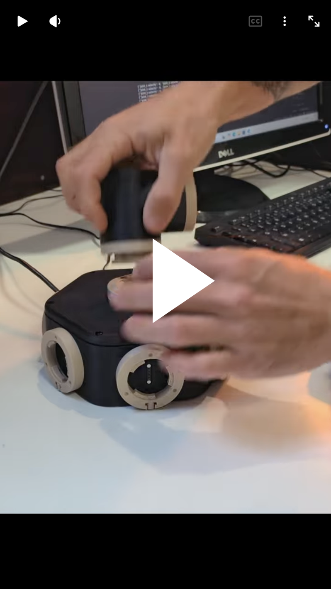
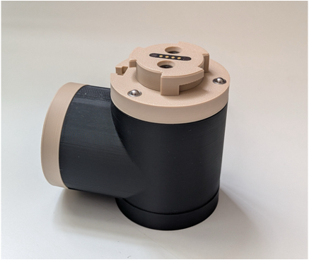
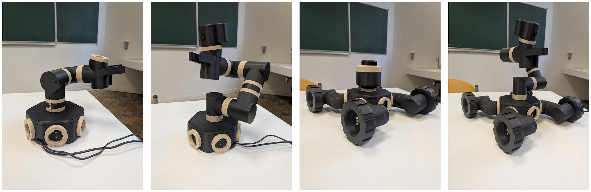

# MIR 

Modular Intelligent Robot

> **MIR** is an open-source modular robotics platform for education, research and experimentation.


<p align="center">
  <a href="https://youtube.com/shorts/KHZeTSOmVA4">
    
  </a>
</p>

<p align="center">
  <em>Build robots in just a few clicks.</em>
</p>

Designed around interchangeable hardware modules, MIR makes it possible to build different robots while sharing a common hardware and software architecture. 
The platform is compatible with the LeRobot ecosystem for robot learning, while remaining suitable for more traditional robotics applications such as kinematics, control, teleoperation, perception and navigation.

<p align="center">
  
</p>

## Examples
The same hardware modules can be used to build different robotic systems, including :

- Robot arms
- Mobile platform with Lidar
- Quadruped

## Why a modular platform ?

Traditional educational robots are often designed for a single purpose. MIR follows a different approach : the same hardware modules can be reused to build different robotic systems. This allows students, teachers and researchers to explore a wide range of robotics topics without redesigning the platform.

<p align="center">
  
</p>


## Project status

This repository documents the development of MIR from its first functional prototype.


## Software

The MIR application lets you build a robot from its modules, simulate it (MuJoCo), drive it, record demonstrations,
and train models (behavior cloning, LeRobot policies such as ACT, reinforcement learning with Stable-Baselines3),
on the real robot or in simulation.

| Folder | Content |
|---|---|
| `mir_robot_editor/` | the MIR application (user interface) |
| `mir_robot/` | `mirRobot`, the single entry point to the robot (real or simulated), training and policies |
| `mir_sim/` | module catalog, MuJoCo model of the robot, simulated devices |
| `mir_devices/` | drivers for the real hardware (Feetech servo bus, cameras, ESP32, lidar) |
| `robots/` | example robots: configuration, scenes, scripts, training scripts |
| `doc/` | documentation (architecture, installation, hardware) |
| `cad/`, `assets/` | 3D models (STL) and pictures of the modules |

## Installation

MIR runs on **Windows**, **macOS** and **Linux**. No administrator rights are needed, and you don't have to install
Python yourself: the [uv](https://docs.astral.sh/uv/) tool downloads Python 3.12 and the exact versions of every
package MIR needs (LeRobot, MuJoCo, PyTorch...).

You need an internet connection and about **5 GB** of free disk space. The first installation takes around 10 minutes.

### Quick install on macOS (Apple Silicon)

Open the **Terminal** app (Spotlight → type "Terminal"), paste this line and press Enter:

```bash
curl -LsSf https://raw.githubusercontent.com/MariusBrtn/mir/main/installer/macos/install_mir.sh | bash
```

It installs uv, downloads MIR into your home folder (`~/MIR`), installs its packages and creates the **MIR** app in
the **Applications** folder (or in `~/Applications` if your account may not write there). Find it with Launchpad or
Spotlight, and drag it to the Dock to keep it. It starts with two simulated
robots: `bras_4ddl_cam_V2` (4-DOF arm with a camera) and `test_mobile` (mobile robot with a lidar). Run the same line
again to update MIR: the `robots/` folder (your work) is never touched. Intel Macs are not supported (PyTorch no longer exists for them).

### Quick install on Linux

Open a **Terminal**, paste this line and press Enter:

```bash
curl -LsSf https://raw.githubusercontent.com/MariusBrtn/mir/main/installer/linux/install_mir.sh | bash
```

If `curl` is missing (as on a fresh Ubuntu), use `wget` instead:

```bash
wget -qO- https://raw.githubusercontent.com/MariusBrtn/mir/main/installer/linux/install_mir.sh | bash
```

It installs uv, downloads MIR into your home folder (`~/MIR`), installs its packages and adds **MIR** to the
applications menu and to the desktop, with the same two simulated robots. On an Intel / AMD PC, plan for about
**12 GB** of free space: PyTorch for Linux comes with CUDA (NVIDIA graphics cards). Near the end, the installer offers
two optional steps, which need your password (`sudo`):
- install `libxcb-cursor0`, a library Qt needs to open MIR's window on Ubuntu / Debian;
- add your account to the `dialout` group, allowed to use the serial port of a real robot (log out and back in
  afterwards).

Answer `n` if you have no administrator rights: MIR works in simulation, and the installer prints the commands for an
administrator. The log is in `~/MIR/logs/application.log`. Run the same line again to update MIR (your `robots/` folder
is never touched). To install elsewhere, put `MIR_DIR=/path/to/MIR` before `bash`, and use it again for each update.

The steps below do the same by hand, on Windows, macOS and Linux.

### 1. Install uv (once)

- **Windows**: open **PowerShell** (Start menu → type "PowerShell") and paste:
  ```powershell
  powershell -ExecutionPolicy ByPass -c "irm https://astral.sh/uv/install.ps1 | iex"
  ```
- **macOS / Linux**: open a **Terminal** and paste:
  ```bash
  curl -LsSf https://astral.sh/uv/install.sh | sh
  ```

Then **close and reopen** the PowerShell / Terminal window, so that the `uv` command is found.

### 2. Download MIR

Either:
- **without git**: on this page, click the green **Code** button → **Download ZIP**, and unzip it where you like;
- **with git**:
  ```bash
  git clone https://github.com/MariusBrtn/mir.git
  ```

### 3. Install MIR

Open PowerShell / Terminal **in the MIR folder** (`mir`, or `mir-main` if you downloaded the ZIP: the folder containing
`pyproject.toml`) and run:

```bash
uv sync
```

You can also double-click **`install.bat`** (Windows) or run **`./install.sh`** (macOS / Linux).
This creates a `.venv` folder containing everything MIR needs; nothing is installed elsewhere on your computer.

### 4. Start MIR

From the same folder:

```bash
uv run mir
```

No robot at hand? Everything works in simulation:
1. in the **Robot** menu, choose **Ouvrir un robot…** (open a robot) and pick an example, such as `bras_4ddl_cam_V2`
   (robot arm with a camera) or `test_mobile` (mobile robot with a lidar);
2. click **Simulé** (simulated) at the top of the window, then explore the steps: drive the robot, record
   demonstrations, train a model, and let it drive the robot (**Piloter → IA**).

### Other commands

```bash
uv run mir-esp32           # setup tool for the ESP32 sensor boards
uv run pytest              # automatic tests (simulation only, no hardware needed)
uv run python my_script.py # run your own Python script with MIR's packages
```

In VS Code, select the Python interpreter of `mir/.venv`.

### Update MIR

```bash
git pull     # or download the ZIP again
uv sync
```

### Real hardware

With a real robot, connect the servo bus adapter (USB) and power the robot, then click **Réel** (real) and connect.
Hardware guides are in [`doc/`](doc/) (in French), for example the
[serial ports guide](doc/serial_ports/Guide_Ports_Serie_Persistants.md) on Linux.

## Authors

MIR is designed and developed by **Marius Bertin** and **Michel Bertin**.

## Citation

This project uses [LeRobot](https://github.com/huggingface/lerobot) by Hugging Face. If you use this project, please cite:

```bibtex
@misc{cadene2024lerobot,
    author = {Cadene, Remi and Alibert, Simon and Soare, Alexander and Gallouedec, Quentin and Zouitine, Adil and Palma, Steven and Kooijmans, Pepijn and Aractingi, Michel and Shukor, Mustafa and Aubakirova, Dana and Russi, Martino and Capuano, Francesco and Pascal, Caroline and Choghari, Jade and Moss, Jess and Wolf, Thomas},
    title = {LeRobot: State-of-the-art Machine Learning for Real-World Robotics in Pytorch},
    howpublished = "\url{https://github.com/huggingface/lerobot}",
    year = {2024}
}
```

## License

MIR is released under the Apache License 2.0.

This project is intended to encourage learning, research and collaboration. Commercial use is permitted under the terms of the Apache 2.0 License.

See the [LICENSE](LICENSE) file for details.

New hardware modules, documentation and software will be added progressively.

