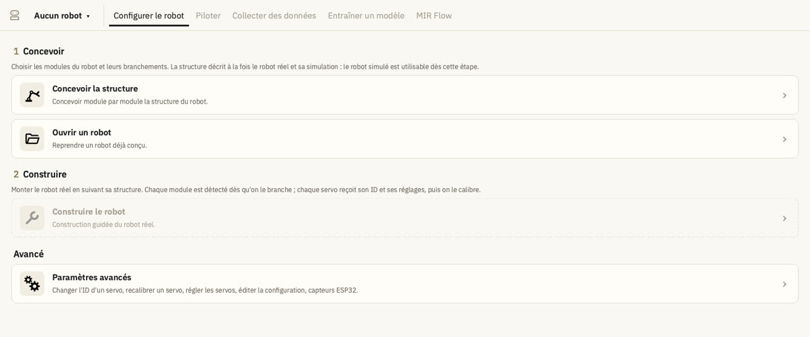

MIR fonctionne sous **Windows**, **macOS** (processeur Apple : M1, M2…) et **Linux**. L'installation :

- ne demande **pas de droits d'administrateur** ;
- n'oblige pas à installer Python soi-même : l'outil [uv](https://docs.astral.sh/uv/) télécharge Python et les
  versions exactes de tout ce dont MIR a besoin (LeRobot, MuJoCo, PyTorch…) ;
- demande une connexion internet et environ **5 Go** d'espace libre.

## Sur Mac : une seule commande

Ouvrez l'application **Terminal** (Spotlight → tapez « Terminal »), collez cette ligne puis appuyez sur Entrée :

```bash
curl -LsSf https://raw.githubusercontent.com/MariusBrtn/mir/main/installer/macos/install_mir.sh | bash
```

La commande installe uv, télécharge MIR dans votre dossier personnel (`~/MIR`), installe ce dont il a besoin et crée
l'application **MIR** dans le dossier **Applications**. Lancez-la depuis le Launchpad ou Spotlight ; vous pouvez la
glisser dans le Dock pour la garder.

## Sur Windows ou Linux

### 1. Installer uv (une seule fois)

- **Windows** : ouvrez **PowerShell** (menu Démarrer → tapez « PowerShell ») et collez :

  ```powershell
  powershell -ExecutionPolicy ByPass -c "irm https://astral.sh/uv/install.ps1 | iex"
  ```

- **Linux** : ouvrez un **Terminal** et collez :

  ```bash
  curl -LsSf https://astral.sh/uv/install.sh | sh
  ```

Fermez puis rouvrez la fenêtre PowerShell ou Terminal, pour que la commande `uv` soit trouvée.

### 2. Télécharger MIR

Sur la page [github.com/MariusBrtn/mir](https://github.com/MariusBrtn/mir), cliquez sur le bouton vert **Code** →
**Download ZIP**, puis décompressez l'archive où vous voulez.

### 3. Installer

Ouvrez PowerShell ou le Terminal **dans le dossier de MIR** (celui qui contient le fichier `pyproject.toml`), puis :

```bash
uv sync
```

Sous Windows, vous pouvez aussi double-cliquer sur **`install.bat`**. La première installation dure une dizaine de
minutes. Tout est rangé dans un dossier `.venv`, à l'intérieur du dossier de MIR : rien n'est installé ailleurs.

### 4. Lancer MIR

Depuis le même dossier :

```bash
uv run mir
```

## Premier lancement

MIR s'ouvre sur l'étape **Configurer le robot**, sans robot ouvert. Deux robots sont fournis pour essayer le
logiciel tout de suite : `bras_4ddl_cam_V2` (un bras avec une caméra) et `test_mobile` (un robot mobile avec un
lidar). Le chapitre suivant en fait le tour.



## Mettre MIR à jour

- **Mac** : relancez la commande d'installation. Vos robots (le dossier `robots/` de MIR) ne sont pas touchés.
- **Windows, Linux** : téléchargez et décompressez le nouveau ZIP, recopiez-y le dossier `robots/` de l'ancienne
  version (vos robots), puis relancez `uv sync` dans le nouveau dossier.
