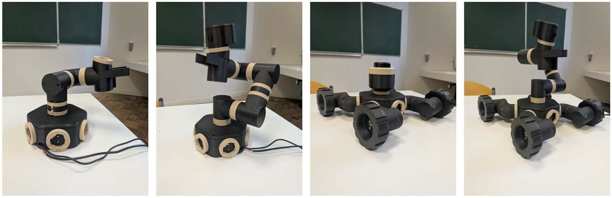
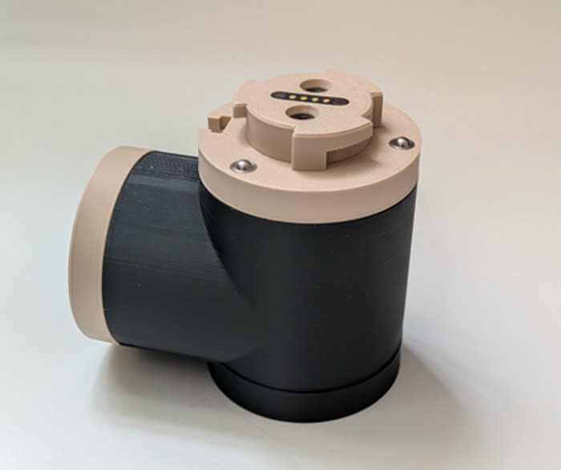
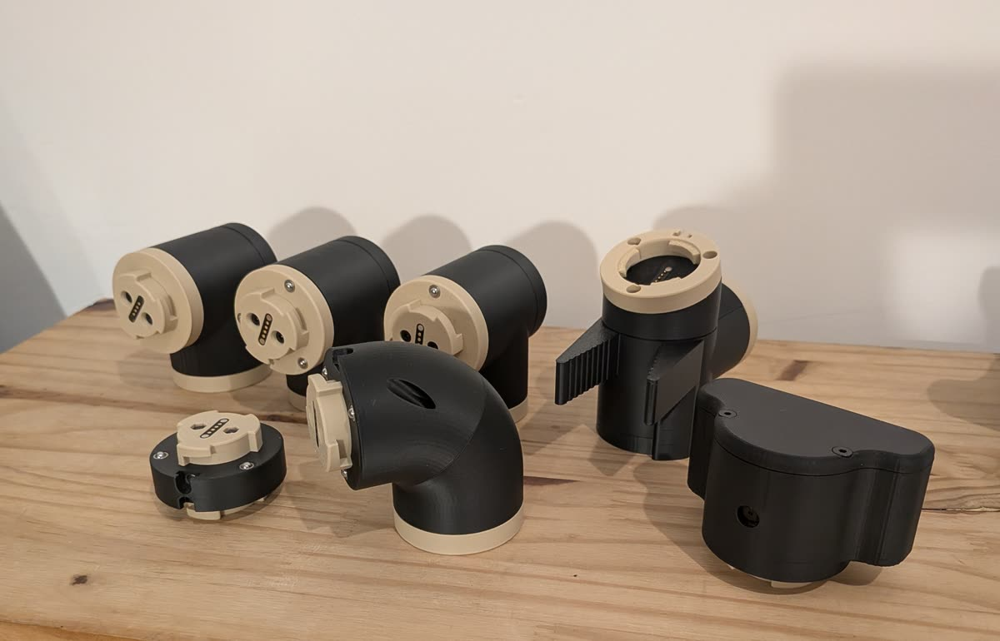
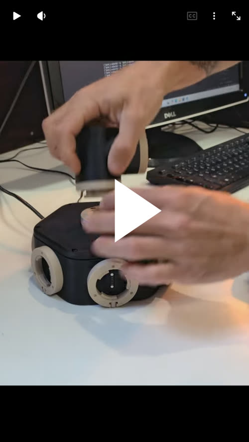

## La plateforme MIR

**MIR** est une plateforme robotique **modulaire**, open source, pensée pour l'enseignement, la recherche et
l'expérimentation. Les mêmes modules matériels (servos, jonctions, coudes, pince, roues, caméra, lidar…) se
combinent pour construire des robots très différents, tout en partageant la même architecture matérielle et
logicielle : un bras robotisé, une plateforme mobile avec lidar, un quadrupède…

::: {.columns}
::: {.column width="48%"}

:::
::: {.column width="4%"}
:::
::: {.column width="48%"}

:::
:::

Les robots pédagogiques sont souvent conçus pour un seul usage. MIR fait l'inverse : on fait évoluer le robot selon
l'activité, en ajoutant ou en remplaçant des actionneurs et des capteurs, sans repartir de zéro. Une même plateforme
couvre ainsi la cinématique, l'asservissement, la téléopération, la perception, la navigation et le *robot learning*.

<a href="https://youtube.com/shorts/KHZeTSOmVA4" class="video-presentation">

Voir MIR en vidéo : un robot construit en quelques clics
</a>

## Le logiciel MIR

L'application MIR accompagne toute la vie d'un robot :

- **le concevoir** module par module, dans un éditeur 3D ;
- **le construire**, guidé pas à pas, chaque module étant détecté dès qu'on le branche ;
- **le piloter**, réel ou **simulé** (moteur physique MuJoCo) : essais d'asservissement, téléopération, scripts
  Python ;
- **enregistrer des démonstrations** et **entraîner des modèles** : behavioral cloning, politiques de LeRobot comme
  ACT, apprentissage par renforcement ;
- **enchaîner des tâches** avec MIR Flow, jusqu'à un modèle de langage qui décide quoi faire.

Un robot est décrit une seule fois : la même description sert au robot réel et à son jumeau simulé. Tout ce qui se
fait avec le robot réel peut se faire en simulation, sans matériel. MIR est compatible avec l'écosystème
[LeRobot](https://github.com/huggingface/lerobot) de Hugging Face.

## Ce site

Ce site propose une **découverte progressive du robot learning par l'expérimentation**. Les activités font émerger
les notions à partir de situations concrètes : observer le comportement d'un robot, enregistrer ses actions,
constituer un jeu de données, entraîner un modèle, puis confier le robot à ce modèle.

Les parcours se suivent dans le menu de gauche :

1. **[Prise en main](prise-en-main.qmd)** : installer MIR et faire le tour de l'application ;
2. **[Apprendre par imitation](behavioral-cloning.qmd)** : le *Behavioral Cloning*, avec un bras simple à trois
   degrés de liberté et une pince.

Tout se fait en simulation : un ordinateur suffit. Les manipulations dans l'application sont montrées dans de
courtes vidéos.

## Le projet

MIR est conçu et développé par **Marius Bertin** et **Michel Bertin**. Le code, les modèles 3D des modules et la
documentation sont sur [GitHub](https://github.com/MariusBrtn/mir), sous licence Apache 2.0. De nouveaux modules,
documents et logiciels sont ajoutés au fil du projet.
