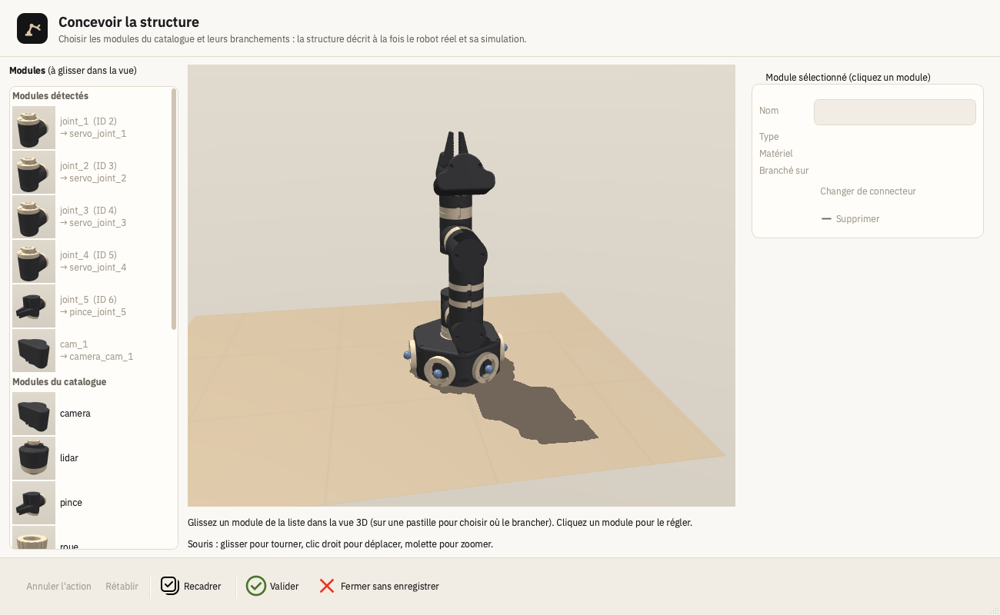
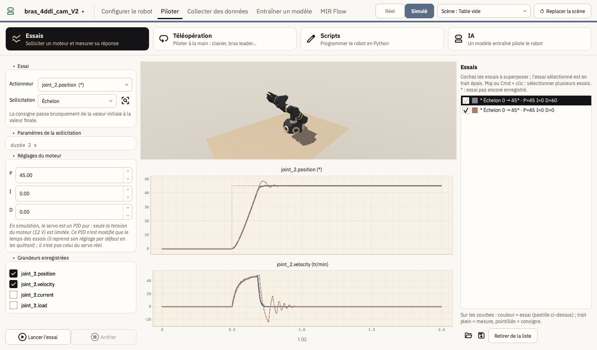
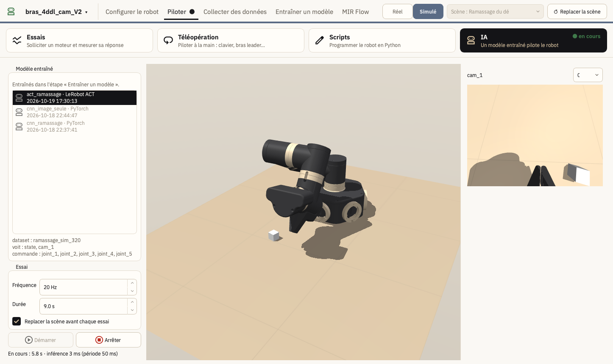
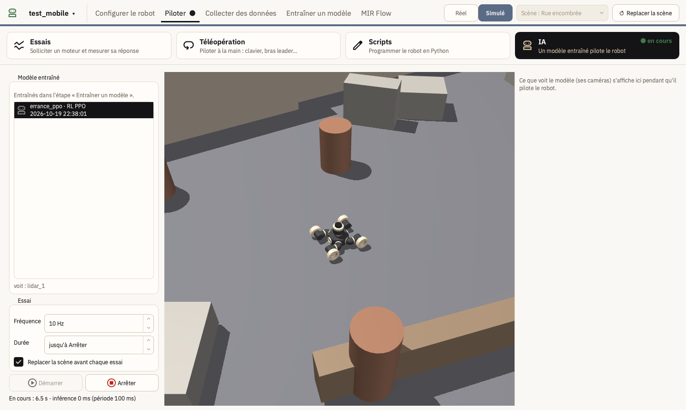
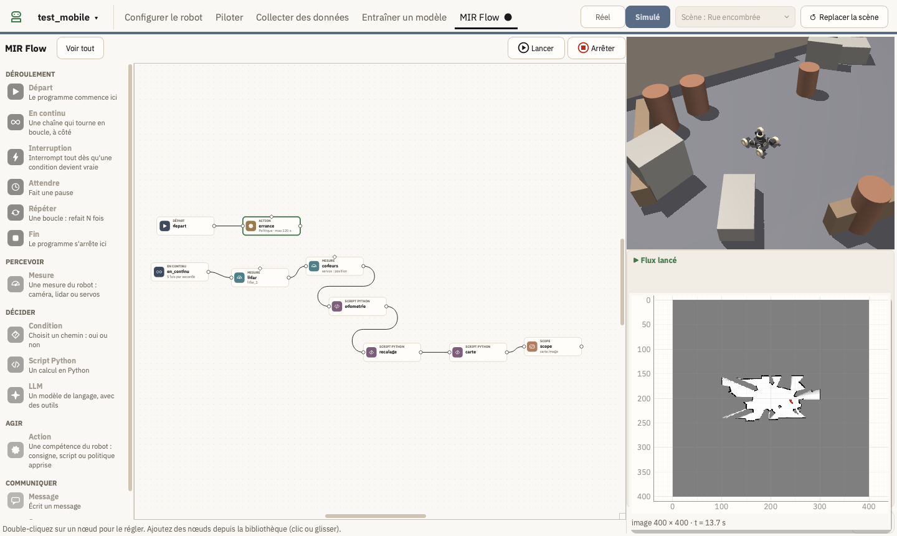

---
aliases:
  - ../prise-en-main.html
  - ../installation.html
  - ../decouverte.html
title: "Installer et découvrir MIR"
subtitle: "Le logiciel sur votre ordinateur, et ce qu'on peut faire avec"
lightbox: true
---

## Installer MIR

MIR fonctionne sous **Windows**, **macOS** (processeur Apple : M1, M2…) et **Linux**. L'installation ne demande pas de droits d'administrateur, ni d'installer Python soi-même : l'outil [uv](https://docs.astral.sh/uv/) télécharge Python et les versions exactes de tout ce dont MIR a besoin (LeRobot, MuJoCo, PyTorch…). Il faut une connexion internet et environ **5 Go** d'espace libre.

### Sur Mac : une seule commande

Ouvrez l'application **Terminal** (Spotlight → « Terminal »), collez cette ligne puis appuyez sur Entrée :

``` bash
curl -LsSf https://raw.githubusercontent.com/MariusBrtn/mir/main/installer/macos/install_mir.sh | bash
```

La commande installe MIR dans votre dossier personnel (`~/MIR`) et crée l'application **MIR** dans le dossier **Applications**. Pour mettre MIR à jour, relancez la même commande : vos robots ne sont pas touchés.

### Sur Windows ou Linux

1.  **Installer uv** (une seule fois). Sous Windows, dans **PowerShell** :

    ``` powershell
    powershell -ExecutionPolicy ByPass -c "irm https://astral.sh/uv/install.ps1 | iex"
    ```

    Sous Linux, dans un **Terminal** :

    ``` bash
    curl -LsSf https://astral.sh/uv/install.sh | sh
    ```

    Fermez puis rouvrez la fenêtre, pour que la commande `uv` soit trouvée.

2.  **Télécharger MIR** : sur [github.com/MariusBrtn/mir](https://github.com/MariusBrtn/mir), bouton vert **Code** → **Download ZIP**, puis décompressez l'archive.

3.  **Installer**, dans le dossier de MIR (celui qui contient `pyproject.toml`) : `uv sync` (ou double-clic sur `install.bat` sous Windows). Comptez une dizaine de minutes la première fois.

4.  **Lancer MIR**, depuis le même dossier : `uv run mir`.

## Ce qu'on fait avec MIR

MIR s'ouvre sur l'étape **Configurer le robot**. Les étapes sont en haut de la fenêtre, de gauche à droite dans l'ordre où on les suit. Deux robots sont fournis pour essayer tout de suite : `bras_4ddl_cam_V2`, un bras avec une caméra, et `test_mobile`, un robot mobile avec un lidar. Sans robot branché, MIR pilote le **robot simulé** : le sélecteur **Réel / Simulé**, en haut à droite, choisit l'un ou l'autre. Avec le vrai robot, un bouton **Arrêt d'urgence** apparaît au même endroit et coupe tout de suite les moteurs.

### Découvrir les bases de la robotique

On assemble un robot module par module : servos, jonctions, pince, caméra, roues… La même structure décrit le robot réel et sa simulation. On fait ensuite bouger ses articulations, on mesure comment un moteur répond à une consigne, et on programme le robot en Python.

::: {layout-ncol="2"}
{.capture group="bases"}

{.capture group="bases"}
:::

### L'IA appliquée à la robotique

On commence par l'apprentissage par imitation le plus simple : le robot copie ce qu'un opérateur lui a montré (*Behavioral Cloning*). On va ensuite jusqu'aux modèles actuels, comme ACT ou les politiques de diffusion. On voit aussi l'apprentissage par renforcement, où le robot apprend seul, par essais et erreurs. Chaque méthode est découverte, puis appliquée dans MIR : on enregistre des démonstrations, on entraîne un modèle, et on le laisse piloter le robot.

::: {layout-ncol="2"}
{.capture group="ia"}

{.capture group="ia"}
:::

### Assembler des tâches complexes avec MIR Flow

MIR Flow assemble des briques dans un graphe : mesures des capteurs, calculs en Python, compétences du robot (une consigne, un script ou un modèle entraîné), décisions, et même un modèle de langage qui choisit quoi faire. Chaque brique reste simple ; c'est leur assemblage qui donne un comportement riche.

{.capture group="flow"}

## Où sont rangés les fichiers

Chaque robot a son dossier dans `robots/` : sa configuration (`robot.json`), ses essais, ses scripts, ses scènes, ses démonstrations (`datasets/`) et ses modèles entraînés (`modeles/`). Ce sont des fichiers ordinaires, que l'on peut copier, échanger ou ouvrir avec un autre logiciel.